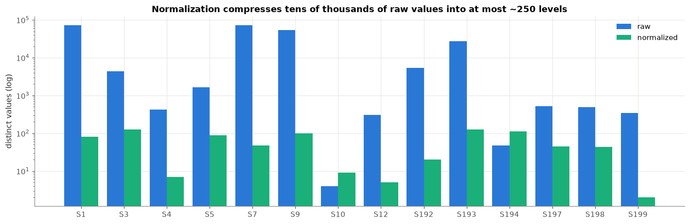

# Predicting Hard Drive Failure from Fleet Telemetry

## 1. Problem

Data centers are one of the most prevalent topics in the tech industry today, since they are powering the recent boom in artificial intelligence. Data centers are massive buildings filled with servers that enable customers to access computing resources they otherwise wouldn't be able to use on their own premises. Much like traditional computers, these servers store data on **hard drives**, which use a physical disk spinning at thousands of revolutions per minute to read and write data. Since these components use a moving part, although rare, there is a possibility of them failing and putting the data stored on them at risk.

Data centers hold hundreds of thousands of drives, and according to our data only about 1.3% of drives at Backblaze data centers failed per year. The problem here isn't that failures are common, it's that with a fleet of this size, a dozen happen every day and nobody knows in advance which ones will fail, making replacing drives a reactive task. Currently, drives are usually replaced once a warning counter trips, but in our data only about half of failing drives (47.9%) showed any bad sectors in the 30 days before failing, making this method of replacement unreliable. Our project aims to make replacing drives a proactive task by predicting if a drive will fail in the next 30 days, based on its readings over the past 30 days and how they changed. Operators work with a fixed weekly budget of spare drives and technician hours. Our project aims to produce a ranked list of drives, with drives at the highest risk of failure listed first, and so on. This way operators could use their weekly resources efficiently and replace drives before they fail.

## 2. Stakeholders and Significance

Drive failure costs the companies running large storage fleets, the smaller teams running their own storage, and the companies that build the drives. Each needs something different from a failure prediction.

Firstly, **data center and cloud storage operators** (Backblaze for example) are responsible for managing hundreds of thousands of drives storing data for their customers. Backblaze, for example, protects data by splitting each file into 20 pieces spread across 20 storage servers, with 17 pieces holding the data and 3 holding backup pieces of that data.[^backblaze_durability] Every failed drive uses up part of that safety margin until the drive is replaced and the data is rebuilt. Replacing a drive before it fails never uses up that margin, putting the data at less risk of being lost. Data center/cloud operators such as Backblaze work with a fixed budget of spare drives and technician hours so they need a set list of which drives to replace first, rather than replacing them as they fail. Today, about half of failing drives show no bad sectors beforehand, so replacing those drives is purely emergency work. A ranked list turns some of those failures into planned replacements.

Another stakeholder in this project is **enterprise IT teams**, these consist of companies running their own storage on a much smaller scale than a company like Backblaze. A company like Backblaze that owns a massive amount of drives only experiences about 1.3% drive failure per year,[^backblaze_drivestats] so a company with a smaller amount of drives, say 500, would only see about 6 or 7 failures per year. That is too few failures for one of these IT teams to learn failure patterns from their own data. They need an early warning of failures that avoids outages they likely don't have the staff or spare parts to absorb. They could likely benefit from using the learned pattern of failure from a company with hundreds of thousands of drives and apply it to their own storage infrastructure.

Finally, **drive manufacturers**, the ones who build the drives and decide what health readings each drive reports could benefit from our project as well. Readings aren't consistent across manufacturers and our data supports this. Some readings are reported on different scales by different manufacturers, and some are not reported at all by certain drive models. The clearest example of this is temperature: in the normalized temperature reading, Seagate reports the actual temperature, Toshiba reports a constant 100, and WDC reports about 59, even though all their drives run at 32 to 35 °C. This project can give manufacturers evidence of which readings actually predict failure, which are missing for some manufacturers, and which are inconsistent. This will help drive manufacturers determine what's worth reporting and hopefully standardize reporting across manufacturers.

## 3. Related Work

Today, most drives are monitored with a fixed threshold. Each drive's own firmware raises an alarm when a health reading crosses a limit set by the manufacturer, and operators like Backblaze investigate a drive once any of a handful of warning counters goes above zero. In a 2016 analysis, Backblaze found that 76.7% of its failed drives had at least one of its five watched counters above zero, compared with 4.2% of working drives. Initially that number can look promising, but on the flip side that means that 23.3% of failed drives gave no warning on those counters at all.[^klein2016] Two large field studies from 2007 help explain why this approach falls short. At Google, Pinheiro, Weber and Barroso found that some readings are strongly tied to failure (e.g. after its first scan error, a drive was 39 times more likely to fail within 60 days), yet over 56% of failed drives had no count in any of the four strongest readings. They concluded that models built on these readings alone are unlikely to predict individual drive failures.[^pinheiro2007] Schroeder and Gibson, studying about 100,000 drives, found that real-world replacement rates were typically 2-4% per year and as high as 13% on some systems, far above the 0.88% implied by manufacturer datasheets, and that replacement rates climbed steadily with age.[^schroeder2007] Our own data shows the same gap: only 47.9% of drives that failed showed any bad sectors in the 30 days before failure.

Machine learning research since then has tried to close this gap by combining many readings instead of watching each one separately. In an early example, Murray, Hughes and Kreutz-Delgado showed that support vector machines (SVMs) and a naive Bayes variant outperformed the threshold alarm built into drives while keeping false alarms low.[^murray2005] Li et al. trained decision trees on 25,792 drives and caught over 95% of failures with a false alarm rate under 0.1%. Their regression tree also gave each drive a health score instead of a simple pass or fail.[^li2014] Botezatu et al. at IBM Research used machine learning to predict disk replacements ahead of time in production data centers.[^botezatu2016] Aussel et al. used the same public Backblaze dataset as this project. They compared SVMs, random forests and gradient-boosted trees and reached over 95% precision and 67% recall on one year of data with roughly 5,000 healthy samples for every failure.[^aussel2017] More recently, Lu et al. reached a combined precision and recall score of 0.95 ten days ahead across 380,000 drives, but did so by adding performance and location data to the drives' own readings. That supports Pinheiro's conclusion that drive health readings alone have a ceiling.[^lu2020] Amram et al. have also argued that these models need to be interpretable for operators to trust and act on them.[^amram2021]

Our project builds on this work in three ways. First, it tests the model on a year it has never seen. Aussel et al. and Lu et al. both trained and evaluated within a single short window (one year and two months, respectively), while we train on 2023 and 2024, and test on all of 2025. This matters because the fleet changes over time: in our data, the failure rate per drive-day fell from about 1 in 21,000 in 2023 to 1 in 27,000 in 2025. Second, rather than reporting accuracy at a fixed alarm threshold, we rank drives by risk and measure how many real failures fall within a fixed replacement budget. This extends the health-score idea from Li et al. into the decision an operator actually makes. Third, we compare nine models, including the gradient-boosted trees Aussel et al. tested, across three years of data rather than one. We also inherit a limit: the public dataset contains only drive health readings, so the ceiling Pinheiro et al. identified applies to our model too, and the extra signals Lu et al. used are not available to us. Because these studies use different datasets, prediction windows and metrics, their reported numbers are not directly comparable to each other or to ours.

## 4. Dataset

### 4.1 Source

The dataset used for this project is a drive stats dataset published by Backblaze, a cloud storage company that publishes its own fleet data.[^backblaze_drivestats] In each of their data centers, Backblaze takes a daily snapshot of each operational drive. Each daily snapshot of one drive is one row of data, meaning each row is one drive on one day. Backblaze releases data as one zip file per quarter, with one CSV file per day inside. Each row holds data that identifies the drive, and metrics about the drive: the date, serial number, model, capacity, SMART health readings (both a raw count and the manufacturer's normalized score), and a failure flag. For our project, we used twelve quarters of this data: Q1 2023 through Q4 2025. We split the data chronologically to create training and test sets, training on 2023 to 2024 (with the last two months of 2024 held back for calibration, see Section 4.2) and testing on 2025. Backblaze makes their data available for public use as long as they are cited as the source. The user is also solely responsible for how they use the data, and derivative work may be sold but the data itself cannot be since it is free.[^backblaze_drivestats]

**Where to find the data.** The data is not stored in our repository. It can be downloaded directly from [Backblaze's Drive Stats page](https://www.backblaze.com/cloud-storage/resources/hard-drive-test-data), and our [README](https://github.com/tkatz123/IST-707-Group-Project#reproducing-the-dataset) lists the commands to download the twelve quarterly archives and the two scripts that rebuild the modeling tables from them (`scripts/build_dataset.py` and `scripts/build_modeling_table.py`). The build is deterministic, so following those steps reproduces the same tables we used.

### 4.2 Size and Features

Across the twelve quarters, the raw data holds 314,457,081 drive-days: 12.2 GB compressed and roughly 110 GB uncompressed as CSVs. The fleet grew over the period from 21.2 million daily records in Q1 2023 to 30.6 million in Q4 2025. The set of columns also changed over time, growing from 179 in Q1 2023 to 197 from Q2 2024 and onward. Because we train on 2023 and 2024 and test on 2025, only the 179 columns present in every quarter are usable. From those, we kept 33: five that identify the drive and day (date, serial number, model, capacity and the failure flag) and 14 SMART attributes, each as both its raw value and the manufacturer's normalized score. We excluded SMART 187 and 188 even though Backblaze highlights them, because only 35% of drives report them and which drives do depends on the manufacturer, so a model could learn the brand instead of the drive's health. We also removed solid state boot drives, which report different readings with different physical meanings: 22 models and 1.142% of rows. That leaves 310,866,734 drive-days across 72 hard drive models. Both figures correct our proposal, which listed 13 SSD models at 0.78% and stated that the best-supported attributes all exceeded 97% coverage.

We then grouped each drive's days into non-overlapping 30-day windows on a fixed calendar starting January 1, 2023, so a given window covers the same 30 days for every drive. Each row of the modeling table is one drive over one window, 3,988,809 rows in total. For each of the 14 attributes, in both forms, we record the first reading in the window, the last reading and the change between them, giving 84 SMART features. Five drive descriptors (model, capacity, days observed in the window, days between the first and last reading, and days observed so far) bring the total to 89 features. The label is 1 if the drive records a failure in the next 30-day window and 0 otherwise. It is the only value that looks forward in time. Of the 13,282 failures in the source data, 12,137 (91.4%) became labeled failures. The rest cannot be labeled: a drive that fails in its first window has no earlier window, the final window has no next window, and windows at split boundaries are removed.

| Split | Period | Rows | Failures | Failure rate |
|---|---|---|---|---|
| Train | Jan 1, 2023 to Oct 21, 2024 | 169,827 | 8,087 | sampled, 20 healthy per failure |
| Calibration | Nov 1 to Dec 20, 2024 | 297,009 | 328 | 1 in 905 (true rate) |
| Test | Jan 1 to Dec 15, 2025 | 3,521,973 | 3,722 | 1 in 946 (true rate) |

We split the table by time, as shown above. Before sampling, the training period had about 1 failure for every 722 windows, so rare that a model would learn to predict "healthy" for almost everything, so we kept every failed window and 20 healthy windows for each one. This sampling makes the model's predicted probabilities too high, which is why the calibration split exists: it is left at the true failure rate and is used to correct those probabilities. It sits at the end of the training period so that its failure rate (1 in 905) is close to the test year's (1 in 946). Calibrating on all of 2023 and 2024 would have carried the higher 2023 failure rate into every prediction. Finally, a window is kept only if the 30 days it predicts fall in the same split, so no information crosses a boundary between training, calibration and testing.

### 4.3 Why We Trust It

We've determined the data is trustworthy for several reasons. The first of which is because the data is collected by Backblaze, a company which owns multiple data centers and hundreds of thousands of hard drives. The data is not recorded by hand, removing manual data entry as a source of error. Every day, a snapshot of every working drive is taken automatically. Failures are recorded by the company that actually runs and replaces the drives, not by customers or manufacturers. Furthermore, Backblaze has published this data publicly and consistently since 2013.[^backblaze_drivestats] This data has been used by outside researchers such as Aussel et al. (mentioned above).[^aussel2017] We ran a cross check on the numbers Backblaze reported to validate the data. Backblaze published that the 2025 totals are 115,638,676 drive days with 4,317 failures.[^backblaze_drivestats] Our cleaned 2025 data holds 116,161,686 drive days, which is within 0.5% of theirs (this gap is unexplained but insignificant with the size of the data). Additionally, Backblaze reports a 2025 failure rate of 1.36%, in line with the roughly 1.3% we cite in Section 1. Backblaze's reputation and published numbers aligning with our own findings gives us confidence that we are working with high quality data.

We also checked the data ourselves before using it. Before choosing any columns, we measured how often each column was filled across all twelve quarters, which is how we found the 35% coverage that ruled out SMART 187 and 188. In the modeling table, no drive appears twice in the same window in any split, and the three splits do not overlap in time. The labels behave like real failures: 99.96% of failures in the training split fall in the drive's last window, so a drive that fails stays failed. The readings are physically plausible: temperatures range from 13 to 59 °C, power-on hours on a typical drive advance by 24 for every calendar day, and no raw counter is negative. Missing data is low and has known causes. The worst column, SMART 197, is missing on 2.2% of training rows, all from two Toshiba models that do not report it. The full audit is in our EDA notebook (eda/EDA_HDD_Failure.ipynb).

The data also has limits. It comes from one company's fleet, so the drive models it contains reflect what Backblaze chose to buy, and our results may not carry over to other data centers' hardware. Backblaze's dataset page does not define exactly when a drive counts as failed, so we rely on its failure flag as given. SMART readings are not reported consistently across manufacturers, whether in scale, in encoding, or in which counters are reported at all (see Sections 2 and 5.4). About 0.2% of rows show counters that should only increase going down, likely from firmware resets or reused serial numbers, which is too few to affect our results. Lastly, 23 training rows list capacity as unknown. We keep these as missing values rather than dropping them, because 5 of the 23 are failures.

## 5. Exploratory Data Analysis

The exploratory data analysis was carried out in the EDA_HDD_Failure.ipynb file, where within class comparisons were carried out. Training data has 8087 failures and the 20:1 down sampling removed healthy windows at random making the SMART attributes in each class unbiased. Most instances of SMART attributes are zero for most drives, to handle this χ² test of independence, Spearman correlation, Kruskal–Wallis, Wilcoxon signed-rank, Wilson intervals and Poisson intervals were used to analyse the data. The test split (2025) is held out until final evaluation. Real-world failure rates use the calibration split, which keeps the natural failure rate. 

### 5.1 Class Imbalance and the Prior Shift Between Train and the Natural-Rate Fleet

We examined the failure rate in each split with the 95% Wilson confidence interval overall and for each window. As the failures are very rare in the original data, the train set was rebalanced. A model trained on the 1:36 ratio gives out a lot of false positives, and if a model would get an accuracy of about 99.9% on the natural-rate data

As a result we came to the conclusion that there is a severe imbalance. The train has 1 failure : 20 healthy (4.76%). Calib is about 1 : 905 (0.110%), a 43× gap. After undoing the down-sampling (each kept healthy window stands for about 36 real ones), the train-period rate is 0.139%, close to calib’s 0.110%, so most of the gap comes from the sampling. A classifier trained on this data will over predict failure. To counter this we need to take into account PR-AUC or set a false alarm rate and recalibrate the predicted probabilities on the calibration split.

| Split | Period | Drive-windows | Failures | Failure rate (95% Wilson CI) | Healthy : failed |
|---|---|---|---|---|---|
| Train | Jan 2023 – Oct 2024 | 169,827 | 8,087 | 4.762% (4.662–4.864%) | 20 : 1 |
| Calibration | Nov – Dec 2024 | 297,009 | 328 | 0.110% (0.099–0.123%) | 905 : 1 |
| Test | Jan – Dec 2025 | 3,521,973 | 3,722 | held out | held out |

### 5.2 Analysis 2: Who Fails? Manufacturer, Model and Age

In this analysis we calculate annual failure rate (afr) for all the manufacturers, and for the 15 most common drive models. We use the calibration split, which keeps the natural failure rate (1 in 905); the test split is held out until final evaluation. We also check if failure is independent of the model and plot afr against drive age. This will help us determine if the failure is dependent on the model, because if it is then there should be equal representation of all models in the train test split. We use the test split for this analysis as the results on the train split will be inflated.

The results show that HGST drives fail at 2.61% per year, about 3× WDC’s 0.85%, and HGST’s confidence interval does not overlap with any other vendor’s. Across the 15 models with at least 5,000 windows (χ² = 113.9, dof = 14, p ≈ 10⁻¹⁷). However, Cramér’s V is only 0.020, a small effect.

We also determined that age does not follows the classic reliability curve, as AFR is 0.92%  in the first and second year and rises to 3.56% at 5-6 years and then falls to1.48% at 7–8 years and 0.88% at 8–10. Another observation is that capacity also has a hand in drive failure. The older 2 TB drives fail most often (2.21%) and 16 TB drives least (0.83%).

  | Capacity | 8 TB | 12 TB | 14 TB | 16 TB | 22 TB |
  |---|---|---|---|---|---|---|---|
  | AFR | 1.46% | 2.21% | 1.67% | 0.83% | **1.27%** |

### 5.3 Analysis 3: SMART Signatures of Failing vs Healthy Drives

In this analysis we check how different the failing values of the 14 SMART attributes are to the healthy ones. We check the % of non-zero values by class and the odds ratio of failure with non-zero values. This will help tell us which attributes carry a signal and whether it is the presence or the size of the value that matters.

The following table shows the attributes, what percantage of the failed drives had a non-zero value for that attribute and the 95% confidence interval.

| Attribute | % non-zero, healthy | % non-zero, failed | Odds ratio (95% CI) |
|---|---:|---:|---:|
| S5 Reallocated Sectors | 3.4% | **47.9%** | 25.9 (24.6–27.3) |
| S197 Current Pending Sectors | 1.2% | **41.5%** | **59.0 (55.4–62.9)** |
| S198 Offline Uncorrectable | 0.8% | **30.9%** | 55.9 (52.0–60.2) |
| S9 Power-On Hours | Always > 0 | Always > 0 | N/A |
| S4 Start/Stop Count | Always > 0 | Always > 0 | N/A |
| S12 Power Cycle Count | Always > 0 | Always > 0 | N/A |
| S193 Load/Unload Cycles | Always > 0 | Always > 0 | N/A |
| S7 Seek Error Rate | 42.0% | 54.8% | 1.67 |
| S1 Read Error Rate | 42.1% | 57.3% | 1.84 |
| S3 Spin-Up Time | 50.4% | 35.3% | 0.54 |
| S194 Temperature | Always > 0 | Always > 0 | N/A |
| S192 Power-Off Retract | 87.7% | 89.9% | 1.24 |
| S199 UltraDMA CRC Errors | 1.4% | 1.6% | 1.09 (0.9–1.3) |
| S10 Spin Retry Count | 0.0% | 0.0% | — |

S5, S197, S198 are seen to be the three most dominant precursors. A non-zero value for these three attributes significantly raises the odds of failure. However they are not sufficient on their own because about half of the failing drives have s5=0 Drives that fail suddenly, for example through electronics, motor or head failure, give no warning in these counters, which caps the recall that SMART alone can achieve

### 5.4 Analysis 4: Raw vs Normalized SMART Values (What Normalization Does)

Every SMART attribute has a RAW and a NORMALIZED value. The RAW value is the physical value of the drive while the normalized value is a 1–253 score that the vendor's firmware derives from the raw value using a formula the vendor does not publish. The purpose of normalization is to put every attribute on a common "health" scale, where 100 (or 200) means new and a falling value means degradation. In this section we test whether that normalization helps or hurts prediction. This will help us determine which of the SMART columns to keep and how do we scale them.

The raw values have upto 72,000 different values, while the normalized values are fewer than 130.This results in lots of detail getting thrown away. For S5, the normalized value stays at 100 until there are thousands of reallocated sectors. The early warning we saw previously is invisible on the normalized scale. For S9, Toshiba's normalized value hits the floor of 1 at about 40,000 h (4.6 years), so every older Toshiba drive looks the same.

Normalization has compressed large numbers of raw values into a few levels:
- S1: 72,495 raw values → 80 normalized levels
- S7: 72,332 → 48
- S9: 53,344 → 100

In the case of temperature Seagate's normalized value is the temperature in °C (median 32). HGST uses a falling curve (median 176). Toshiba reports a constant 100. WDC reports about 59. Even though the actual temperatures are almost the same (32–35 °C). S199's normalized baseline is 100 for WDC and 200 for everyone else. What we suggest is training the model on raw SMART values. We need to keep the vendor explicit feature and from the normalized values that are duplicate and are confounded with vendor.

### 5.5 Analysis 5: Correlation, Redundancy and Degradation

This analysis has 2 parts; (1) a spearman rank correlation, (2) whether the change during a window adds signal beyond the window.

Correlated features waste model capacity and make linear coefficients unstable. The table show the mode redundant attributes:

| Pair | Spearman ρ | Meaning |
|---|---|---|
| S4 Start/Stop ↔ S12 Power Cycles | **+0.997** | Effectively the same variable; keep one |
| S1 Read Error ↔ S7 Seek Error | +0.901 | Both Seagate-encoded composites (vendor artefact) |
| S9 Power-On Hours ↔ Capacity | **−0.845** | Bigger drives are newer, so age and capacity are confounded |
| S197 Pending ↔ S198 Uncorrectable | +0.803 | Related but not identical; keep both |
| S3 Spin-Up ↔ S7 / S1 / S193 | −0.74 to −0.76 | Vendor encoding again |

We can see clear correlation between s4 and s12 so we can drop one. S1 and S7 also have a high correlation and their correlation with other attributes is similar thus one of them could also be dropped. S197 and S198 are strongly related but their correlation with other attributes is not identical, so both stay.

The following table shows the attribute and the degradation it has during the final 30 days.

| Attribute | AUC of level | AUC of change | % failed with an increase | % healthy with an increase | Lift |
|---|---|---|---|---|---|
| S5 Reallocated | 0.725 | 0.656 | 32.6% | 0.6% | **54×** |
| S197 Pending | 0.702 | 0.594 | 25.4% | 0.3% | **82×** |
| S198 Uncorrectable | 0.651 | 0.574 | 17.1% | 0.2% | **97×** |
| S193 Load/Unload | 0.602 | 0.567 | 80.0% | 69.8% | 1.1× |
| S9 Power-On Hours | 0.632 | 0.511 | 99.9% | 99.9% | 1.0× |

We can see the growing amount of failures. A large number of drives gain error counters before failing. On its own, the change is slightly weaker than the level (S5: 0.656 vs 0.725). Many failing drives already had errors at the start of the window. S9 rises in almost every window for both classes. 

## 6. Baselines

### 6.1 Operational Threshold Baseline

### 6.2 Random or Null-Hypothesis Baseline

### 6.3 Baseline Evaluation Metrics

## 7. Best Model So Far

### 7.1 Model Description

### 7.2 Training and Validation Setup

### 7.3 Evaluation Metrics

### 7.4 Results

### 7.5 Comparison with Baselines

### 7.6 Interpretation and Limitations

## 8. Future Work

### 8.1 Remaining Modeling Tasks

### 8.2 Model Tuning and Probability Calibration

### 8.3 Manufacturer-Bias Audit

### 8.4 Final Evaluation and Error Analysis

### 8.5 Timeline and Deliverables

## 9. Problems and Challenges

### 9.1 Class Imbalance

In the original dataset 1 in 945 drive windows ends in failure. This led to four major problems:
1. Misleading Metrics: Accuracy can not be used to test how good the model is.If the model guessed healthy for all the drives then it would get an accuracy close to 99% We therefore use precision recall curves to test how good the model is. 

2. Train/Test Prior Shift: We down sampled the train set to 1:20 ratio which led to a 4.76% positive record, which is 45 times the test prevalence. A model trained on this data produces an inflated failure rate..

3. Cost of False Positive: The EDA shows how hard precision will be. Even the strongest simple rule we discovered "any of S5, S197, S198 is non-zero", flags 5.5% of the drive windows in which only 1.25% are true positives. Thus the threshold we choose must be explicit and not a default value,

4. Limited Data for some groups. Some models have insufficient failures in the data set for the model to truly understand them. The failure rate estimates are near 0% if normal approximation is used, so we use poisson confidence intervals to estimate their failure rate.

### 9.2 Missing and Manufacturer-Dependent SMART Attributes

S197 is missing for 2.2% of training rows. Every missing value comes from two Toshiba variants (MG08ACA16TEY, MG07ACA14TEY) that do not report the attribute. As this missingness is not random but tied to the model, mean or median imputation will result in false healthy readings, so we keep these values as 'NaN'.

Another issue we observed is the Vendor specific encoding on the SMART attributes. SMART is only loosely standardised. Seagate stores S1 (read error rate) and S7 (seek error rate) as 48-bit composite values in the tens of millions, while other vendors report. The normalized temperature is the actual °C for Seagate, a falling curve for HGST and a constant 100 for Toshiba. Thus some attributes look simple and would reveal the manufacturers and cause leakage.

### 9.3 Temporal Distribution Shift and Unseen Drive Models

The training set covers 2023 - Oct 2024 and the test set covers 2025. Evaluation therefore shows real world development. The health of median healthy drivers went from 2.9 to 3.4 years, the capacity shifted drastically as the news models had a 20-24 Tb storage. The newer models never appeared in the test set, and the last test windows show an artificially low failure rate. Taking all this into account we decided to perform vendor and capacity features over raw model identity and consider age features relative to each model's population.

### 9.4 Challenges Encountered and Workarounds

| Challenge | Why it was a problem | Workaround |
|---|---|---|
| Down-sampled training data | Failure rates computed on train are inflated about 45× | Real-world rates (AFR, risk by bucket) computed on the natural-prevalence test split. Where train was needed, negatives re-weighted ×20 |
| Rare events near 0% | Normal-approximation confidence intervals produced impossible negative bounds for small windows (e.g. 1 failure in 258 rows gives −0.37% to 1.15%) | Wilson score intervals for proportions; exact Poisson intervals for annualised rates |
| Zero-inflated, heavy-tailed counters | Means, Pearson correlation and t-tests dominated by outliers | Non-parametric tests (Mann–Whitney, KS, Spearman, Kruskal–Wallis, Wilcoxon), Cliff's δ effect sizes, log-scale plots |
| Odds ratios for counters that are always non-zero | "Odds of failure if non-zero" is undefined when nearly every drive is non-zero (e.g. S9, S194) | Reported "n/a" for those attributes and relied on Cliff's δ and KS instead |
| Vendor-encoded attributes | Apparent signal in S1, S3, S7 and normalized S194/S199 reflects manufacturer, not health | Within-vendor AUC computed alongside pooled AUC; vendor-confounded attributes flagged |
## 10. Conclusion

## References

[^backblaze_durability]: Backblaze. "Resiliency, Durability, and Availability." *Backblaze B2 Cloud Storage Documentation*. Accessed October 15, 2026. https://www.backblaze.com/docs/cloud-storage-resiliency-durability-and-availability

[^backblaze_drivestats]: Backblaze. "Hard Drive Reliability Test Data." *Backblaze Drive Stats*, Q1 2023 through Q4 2025 quarterly archives. Accessed October 15, 2026. https://www.backblaze.com/cloud-storage/resources/hard-drive-test-data

[^pinheiro2007]: Pinheiro, E., Weber, W.-D. and Barroso, L. A. "Failure Trends in a Large Disk Drive Population." *Proceedings of the 5th USENIX Conference on File and Storage Technologies (FAST '07)*, 2007. https://www.usenix.org/legacy/event/fast07/tech/full_papers/pinheiro/pinheiro.pdf

[^schroeder2007]: Schroeder, B. and Gibson, G. A. "Disk Failures in the Real World: What Does an MTTF of 1,000,000 Hours Mean to You?" *Proceedings of the 5th USENIX Conference on File and Storage Technologies (FAST '07)*, 2007. https://www.usenix.org/legacy/event/fast07/tech/schroeder/schroeder.pdf

[^klein2016]: Klein, A. "What SMART Stats Tell Us About Hard Drives." *Backblaze Blog*, October 6, 2016. https://www.backblaze.com/blog/what-smart-stats-indicate-hard-drive-failures/

[^murray2005]: Murray, J. F., Hughes, G. F. and Kreutz-Delgado, K. "Machine Learning Methods for Predicting Failures in Hard Drives: A Multiple-Instance Application." *Journal of Machine Learning Research*, 6, 2005, pp. 783-816. https://jmlr.org/papers/v6/murray05a.html

[^li2014]: Li, J., Ji, X., Jia, Y., Zhu, B., Wang, G., Li, Z. and Liu, X. "Hard Drive Failure Prediction Using Classification and Regression Trees." *2014 44th Annual IEEE/IFIP International Conference on Dependable Systems and Networks (DSN)*, 2014, pp. 383-394. https://doi.org/10.1109/DSN.2014.44

[^botezatu2016]: Botezatu, M. M., Giurgiu, I., Bogojeska, J. and Wiesmann, D. "Predicting Disk Replacement towards Reliable Data Centers." *Proceedings of the 22nd ACM SIGKDD International Conference on Knowledge Discovery and Data Mining*, 2016, pp. 39-48. https://doi.org/10.1145/2939672.2939699

[^aussel2017]: Aussel, N., Jaulin, S., Gandon, G., Petetin, Y., Fazli, E. and Chabridon, S. "Predictive Models of Hard Drive Failures Based on Operational Data." *16th IEEE International Conference on Machine Learning and Applications (ICMLA)*, 2017, pp. 619-625. https://doi.org/10.1109/ICMLA.2017.00-92

[^lu2020]: Lu, S., Luo, B., Patel, T., Yao, Y., Tiwari, D. and Shi, W. "Making Disk Failure Predictions SMARTer!" *18th USENIX Conference on File and Storage Technologies (FAST '20)*, 2020, pp. 151-167. https://www.usenix.org/conference/fast20/presentation/lu

[^amram2021]: Amram, M., Dunn, J., Toledano, J. J. and Zhuo, Y. D. "Interpretable Predictive Maintenance for Hard Drives." arXiv:2102.06509, 2021. https://arxiv.org/abs/2102.06509
